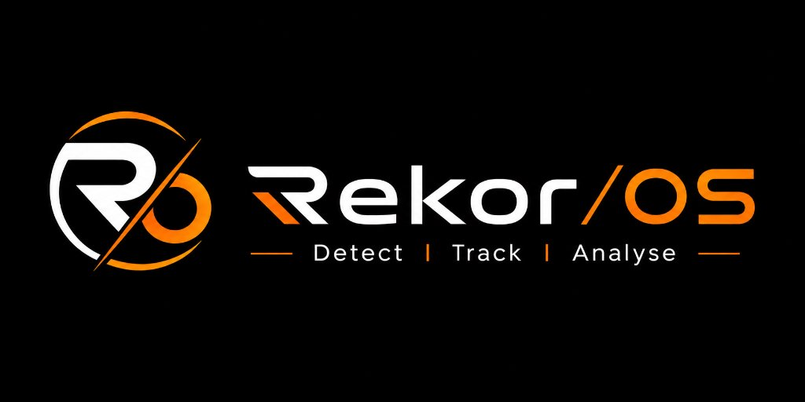
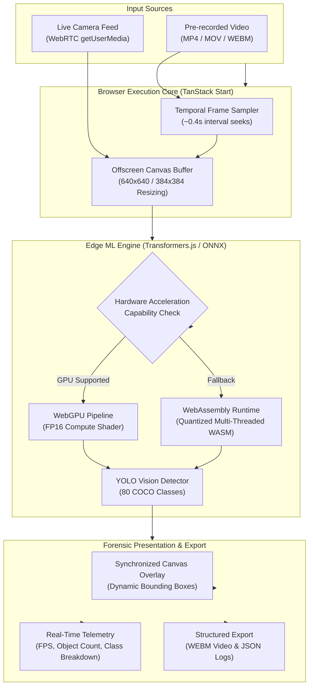

<p align="center">
  
</p>

<h1 align="center">Rekor/OS</h1>
<h3 align="center">Multi-Object Detection, Tracking & Forensic Computer Vision Workspace</h3>

<p align="center">
  <strong>A high-performance, browser-native edge AI computer vision platform for real-time multi-object detection and video tracking. Powered by Transformers.js, ONNX Runtime Web, and TanStack Start, Rekor/OS delivers zero-latency, 100% on-device visual intelligence with complete data privacy.</strong>
</p>

<p align="center">
  
  
  
  
  
  
  
</p>

<p align="center">
  <a href="https://rekor-os.lovable.app" target="_blank">
    
  </a>
</p>

<p align="center">
  &#128279; <strong>Live App URL:</strong> <a href="https://rekor-os.lovable.app" target="_blank">https://rekor-os.lovable.app</a>
</p>

---

## 📑 Table of Contents

- [👁️ Overview](#️-overview)
- [📊 System Architecture & ML Pipeline](#-system-architecture--ml-pipeline)
- [✨ Core Features](#-core-features)
- [🛠️ Technology Stack](#️-technology-stack)
- [📁 Project Structure](#-project-structure)
- [🚀 Getting Started](#-getting-started)
  - [Prerequisites](#prerequisites)
  - [1. Clone & Install Dependencies](#1--clone--install-dependencies)
  - [2. Run Development Server](#2--run-development-server)
  - [3. Build for Production](#3--build-for-production)
- [🔒 Edge AI & Privacy Architecture](#-edge-ai--privacy-architecture)
- [📄 License](#-license)

---

## 👁️ Overview

**Rekor/OS** is a forensic-grade, browser-first computer vision operating system engineered for real-time multi-object detection, motion tracking, and telemetry analysis in video streams. Traditional video analytics pipelines depend heavily on expensive GPU cloud infrastructure, requiring uncompressed video frames to be transmitted over public networks — introducing high bandwidth costs, latency bottlenecks, and acute privacy vulnerabilities.

Rekor/OS revolutionizes this paradigm by running deep learning neural networks **entirely within the user's browser** via **Transformers.js** and **ONNX Runtime Web**. Whether analyzing recorded surveillance clips (MP4 / MOV / WEBM) or live camera feeds via WebRTC, all tensor computations execute locally on the device's WebGPU or multi-threaded WebAssembly (WASM) hardware.

### Key Value Propositions:

- **100% Client-Side Private Inference**: Zero frames, zero video bytes, and zero facial or vehicular telemetry ever leave the client machine.
- **Hardware-Accelerated Edge ML**: Auto-detects device capabilities to leverage WebGPU FP16 acceleration, with seamless fallback to quantized WASM (q8) on low-power devices.
- **COCO 80-Class Broad Detection**: Accurately localizes and classifies people, vehicles (cars, trucks, buses, motorcycles), animals, and everyday objects in complex urban scenes.
- **Forensic Video Intelligence**: Side-by-side comparative playback, confidence filtering, class-specific distribution charts, and frame-synchronous bounding box annotations.
- **Multi-Format Structured Export**: Export annotated video records (`.webm`) with overlays baked in, alongside millisecond-level structured JSON detection logs.

---

## 📊 System Architecture & ML Pipeline



---

## ✨ Core Features

### 1. 🎯 Real-Time Object Detection (80 COCO Classes)
- Identifies and bounds multiple concurrent targets across 80 COCO categories (pedestrians, cyclists, automobiles, freight trucks, traffic lights, backpacks, animals).
- Dynamically configurable confidence score thresholding (default: 0.35–0.40) to minimize false positives in busy scenes.

### 2. 📹 Dual Analysis Workspaces
- **File Upload Mode (`/track`)**:
  - Drag-and-drop video ingestion for MP4, MOV, and WEBM formats.
  - Step-by-step processing tracker: Model Download ➔ Frame Analysis ➔ Overlay Generation ➔ Forensic Review.
  - Interactive playback scrubber with temporal detection caching.
- **Live Camera Stream (`/live`)**:
  - Real-time continuous inference over local webcams or mobile camera sensors.
  - Live FPS counter and active object count HUD.
  - One-click still frame snapshot capture (PNG) and annotated video clip recording (WEBM).

### 3. 🔍 Side-by-Side Forensic Review
- Dual synchronized video viewports comparing the raw original footage against the annotated detection feed.
- Dynamic color-coded bounding boxes with class tags, confidence percentages, and movement tracking trails.
- Comprehensive per-class distribution bar charts and cumulative detection summaries powered by Recharts.

### 4. 💾 Forensic Data & Video Export
- **Annotated Video Export**: Generates downloadable WEBM recordings with visual bounding boxes, labels, and timestamps baked directly into the video stream.
- **Structured JSON Telemetry**: Exports machine-readable frame-by-frame detection coordinates (`xmin`, `ymin`, `xmax`, `ymax`), timestamps, confidence scores, and labels for downstream analysis.

---

## 🛠️ Technology Stack

| Layer | Technology | Purpose |
| :--- | :--- | :--- |
| **Framework** | TanStack Start (React 19) | Modern full-stack SSR/SSG React framework with file-based routing |
| **Build Tool** | Vite 8 | Lightning-fast development server & optimized production bundler |
| **ML Engine** | Hugging Face Transformers.js | In-browser deep learning inference for ONNX computer vision models |
| **Vision Detector** | YOLO-style Detector (`Xenova/yolos-tiny` / YOLOv10) | NMS-free, lightweight 80-class real-time object detector |
| **Compute Backends** | WebGPU & WebAssembly (WASM) | Hardware-accelerated GPU shaders with quantized CPU fallback |
| **Styling & UI** | Tailwind CSS v4 & shadcn/ui | Dark forensic styling, responsive grid layouts, and Radix UI primitives |
| **Visualizations** | Recharts & Lucide Icons | Real-time object distribution graphs and technical telemetry iconography |
| **Media APIs** | Canvas API, MediaRecorder, WebRTC | In-browser frame capture, video rendering, and client-side encoding |

---

## 📁 Project Structure

```text
rekor-os/
├── public/
│   ├── banner.jpg           # Project showcase banner
│   ├── favicon.ico          # Application favicon
│   └── robots.txt           # Search engine directives
├── src/
│   ├── assets/              # Logos and graphics
│   ├── components/
│   │   ├── ui/              # Radix UI / shadcn/ui component library
│   │   └── VideoUpload.tsx  # Drag-and-drop video ingestion component
│   ├── hooks/               # Custom React hooks (useMobile, etc.)
│   ├── lib/
│   │   ├── detector.ts      # Transformers.js model loader & WebGPU inference logic
│   │   ├── tracker.ts       # Video frame sampling & bounding box interpolation
│   │   ├── tracker-store.ts # In-memory detection cache & state store
│   │   └── utils.ts         # Formatting & styling helper functions
│   └── routes/
│       ├── __root.tsx       # Root layout shell with navigation bar
│       ├── index.tsx        # Forensic dashboard landing page & mode selector
│       ├── track.tsx        # Uploaded video processing & side-by-side review
│       ├── live.tsx         # Live camera detection, HUD telemetry & snapshot capture
│       └── record.tsx       # Video recording studio with direct tracking dispatch
├── package.json             # Dependencies and build scripts
└── vite.config.ts           # Vite bundler configuration
```

---

## 🚀 Getting Started

Follow these steps to set up and run Rekor/OS locally on your machine.

### Prerequisites

- [Node.js](https://nodejs.org/) (version **18.x** or higher, recommended **20+**)
- `npm`, `pnpm`, or `bun` package manager
- A modern browser with WebGPU or WebAssembly support (Chrome, Edge, Firefox, or Safari)

### 1. 📥 Clone & Install Dependencies

```bash
git clone https://github.com/dipzz0/Rekor-OS.git
cd Rekor-OS
npm install
```

### 2. 💻 Run Development Server

```bash
npm run dev
```

Open your browser and navigate to `http://localhost:3000` to access the Rekor/OS workspace!

### 3. 📦 Build for Production

```bash
npm run build
npm run preview
```

---

## 🔒 Edge AI & Privacy Architecture

- **Zero Cloud Transmission**: Rekor/OS is strictly a client-side edge application. No video frames, camera inputs, or detection coordinates are sent to any remote server or third-party cloud.
- **Ephemeral In-Memory Processing**: Uploaded video files and live video streams are handled as local object URLs in browser memory and are automatically freed upon closing or navigating away.
- **On-Demand Camera Access**: Camera access (`getUserMedia`) is requested explicitly by the user and can be stopped at any time via the hardware control toggle.

---

## 📄 License

This project is licensed under the [MIT License](LICENSE) — feel free to use, modify, and build upon it.

<p align="center">
  Built for edge computer vision, automated surveillance & forensic video analysis. 🎯
</p>
